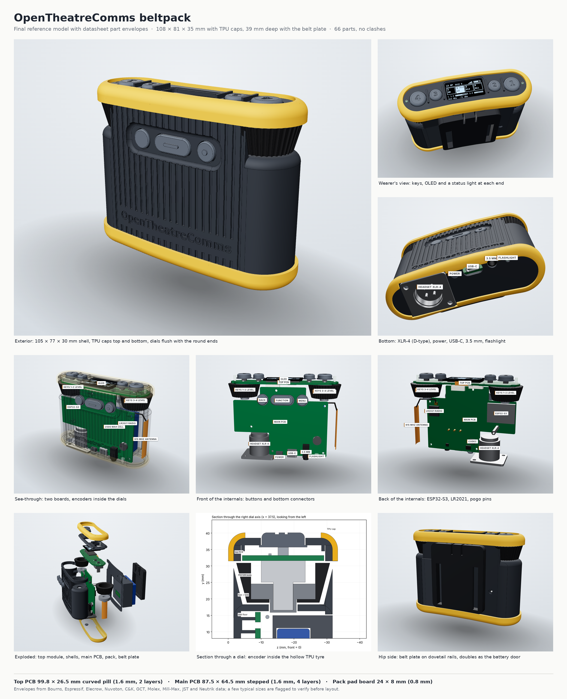

# OpenTheatreComms beltpack

An open, DIY full-duplex wireless theatre intercom beltpack in the spirit of the Hollyland Solidcom M1 and Clear-Com FreeSpeak II.
It uses an ESP32-S3 with an LR2021 radio on 915–928 MHz (Australia), talks to PoE base stations over a 20 ms TDMA frame,
and is 3D printed and hand-assembled.



## What's here

| Path | Contents |
|---|---|
| `cad/final_bp.py` | CadQuery model of the whole beltpack: shells, TPU caps, dials, keys, both PCBs and every bought part as a datasheet envelope |
| `cad/geom.py` | Shared shape helpers (the curved pill plan, edge fillets, the flat-top frame) |
| `cad/clash.py` | Pairwise interference check across all 71 parts |
| `cad/export_boards.py` | KiCad hand-off: DXF outlines with true arcs, placement layers and dimensioned drawings |
| `cad/make_kicad.py`, `cad/make_enclosure_ref.py` | Build the KiCad projects (needs KiCad's `pcbnew` Python module) and the enclosure STEP |
| `cad/section.py`, `cad/size_table.py` | Section drawings and the placement CSV |
| `cad/out/beltpack_final.step` | Full assembly (STEP) |
| `cad/out/stl/` | Every printed part as STL |
| `cad/out/kicad/` | Board outlines (DXF), drawings, placement CSV |
| `kicad/` | Finished KiCad projects, each with a README and `fab/` outputs (Gerbers, drill, BOM, placement, schematic PDF, previews): beltpack main board, top board, pack lid and dock contact board, and the base station carrier |
| `pcb/` | The Python that generates each board: `design.py` (parts and nets), schematic, placement, routing, finishing and fab outputs |
| `order/` | The v1 order for 2 beltpacks + 1 base station: JLCPCB board settings and stencils, the LCSC cart (all parts hand-fitted), other suppliers, and the assembly guide (`ORDER_README.md`) |
| `renders/` | Render sheet and individual renders |
| `viewer/` | Interactive three.js viewer (open `viewer/index.html` from a local web server) |

The firmware and system architecture, the BOM and the open decisions live in the
[architecture doc](https://claude.ai/artifact/WxYNr5Pqa9sfHdBBrxbrdB). The [3D viewer](https://claude.ai/artifact/3vzgMREVLjprdXMhVy1U9x)
is the same page as `viewer/`.

## The pack

- **Size:** 105 × 77 × 30 mm shell (108 × 81 × 35 mm with the TPU caps, 39 mm deep with the belt plate). The back follows a 400 mm radius to sit on the hip.
- **Controls:** four talk keys and a 1.3 in OLED on the flat top, a detented dial at each round end, Back / Function / Menu in a recessed panel on the front.
- **Bottom:** XLR-4 male (D-type), power button, USB-C, 3.5 mm TRRS, flashlight.
- **Power:** a 104050 Li-ion pack (2500 mAh) forms the back of the case; the belt plate slides up its rails and locks it in. Three spring pins carry battery +, NTC and battery −; a JST XH 2-pin socket (J11) on the main board is a second battery input for a wired cell or bench supply.
- **Dock contacts:** four contact pads in the case bottom (VBUS, D+, D−, GND) on a small contact board lying in the case bottom under
  the battery pack, cabled flat to J12, a vertical socket at the main board's bottom edge. A dock charges the pack and talks USB to it (pairing, settings, firmware); a diode keeps the USB-C's 5 V off the pads.
- **Boards:** a curved top PCB (99.8 × 26.5 mm) under the keys carrying the OLED, six RGB lights on an LP5024 driver and both encoders, and a vertical main PCB (87.5 × 64.5 mm) carrying the MCU, radio, codec, power and connectors. A 10-way JST SH cable links them.
- **Radio:** an Elecrow LR2021 module on 915–928 MHz with switched antenna diversity: a PE4259-type switch (HX4259-63) picks between two flex antennas, one inside each round end, every frame.

## Rebuilding

Needs Python 3 with `cadquery`, `ezdxf`, `matplotlib` and `Pillow`.

```sh
cd cad
python3 final_bp.py       # model, STEP, GLB, STLs, parts_final.json (about a minute)
python3 clash.py          # interference check: expect "CLASHES: 0"
python3 export_boards.py  # DXFs and drawings into out/kicad
python3 section.py        # section drawings
python3 size_table.py     # placement.csv
python3 build_viewer.py   # viewer/index.html + viewer/beltpack.json
python3 make_enclosure_ref.py && python3 make_kicad.py   # KiCad projects in ../kicad (needs KiCad 7+)
```

## Base station

A 150 x 90 mm 2-layer carrier for a Waveshare ESP32-P4-NANO (Ethernet for AES67, optional PoE), with the same LR2021 radio and
two edge SMA antennas, a DC input (7-24 V buck), a 1.3 in OLED, four talk keys with RGB lights, eight beltpack lights and a menu dial.
It has no audio of its own: the operator's headset is a beltpack plugged into the base by USB-C. See `kicad/base_pcb/README.md`.

## Status

**Boards:** all five are laid out and pass KiCad DRC with 0 errors and 0 unconnected pads. The v1 order (`order/`) is ready, at about
A$410 for 2 beltpacks + 1 base station, with every part hand-fitted from solder-paste stencils.

**Case:** to be redone around the cheaper parts chosen for v1. The pack pads move to 4.0 mm from the main board's back face for the
Xinyangze spring pins; it needs room for the 7 mm JST XH socket on the main board's front and the Alps EC11 dials' shaft length, and a pocket in
the bottom for the dock contact board. The base station's dock side (spring pins, switched VBUS, USB host) is still to design.

**Reference model notes:**

The CAD model was the reference for the KiCad layout. A few part envelopes are typical sizes still to check against
the exact parts you buy: the encoder body height, the XLR D-flange and depth, USB4105, the PTS815 height variant, the side tact switch,
the JST SH bodies and where the OLED panel's active area sits on its glass. See `cad/out/kicad/README.md`.
