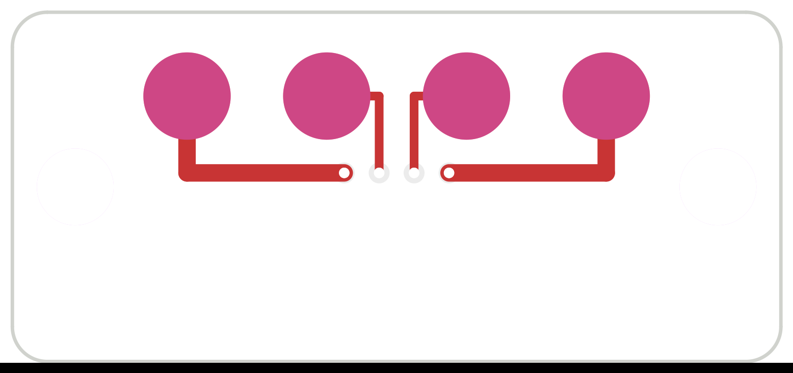

# Beltpack dock contact board, rev 0.1

The beltpack's dock contacts: four gold pads in the case bottom where the base station dock's spring pins land. They
carry USB, for charging and data (pairing, settings and firmware updates through the dock).

| | |
|---|---|
| Size | 22 x 10 mm, 0.8 mm FR4, 2 layers, ENIG, two M2 holes (2.2 mm) at x 1.8 and 20.2 |
| Outside face (F) | Four 2.5 mm ENIG pads at 4.0 mm pitch, on the board's centre line 7.6 mm from the bottom edge. Left to right: **VBUS, D+, D−, GND** |
| Inside face (B) | JST SH 4-pin vertical socket (BM04B-SRSS-TB or -TBT), pin 1 VBUS, 2 D+, 3 D−, 4 GND |
| DRC | 0 errors, 0 unconnected. Four warnings: the test-point pads' library graphics were moved off the silkscreen |

## Wiring

A 4-way JST SH cable (1.0 mm pitch, pin 1 to pin 1, "same side" ends, about 60–80 mm) runs to the main board's **J12**
(SM04B-SRSS-TB, at the main board's bottom edge, back face). On the main board:

- **VBUS** goes through **D12** (B5819W Schottky) into the pack's VBUS, so the dock charges the pack exactly like the
  USB-C does. The diode also keeps the USB-C's 5 V off these exposed pads when a cable is plugged in.
- **D+ / D−** join the ESP32-S3's USB lines, which the main board's USBLC6 (U1) already protects. Use the dock or the
  USB-C, not both at once.
- **GND** is the main board's ground.

## For the dock (base station side, to come)

- Spring pins at the same 4.0 mm pitch, landing on the pads' centres; 2.5 mm pads leave about ±0.8 mm of alignment
  tolerance for a 1 mm pin tip.
- Switch the dock's VBUS on only when a pack is sensed (or current-limit it), since the pins are exposed when empty.
- The dock is a USB host for D+/D− (the ESP32-P4 has USB host), or a USB hub to a PC for firmware updates.

## Case

The board sits in a pocket in the case bottom with its pads flush with (or slightly proud of) the outside surface, held
by two M2 screws. Keep it clear of the XLR, USB-C and 3.5 mm openings.

## Rebuilding

Generated from `pcb_dock/design.py`: `python3 make_sch.py`, `kicad-cli sch export netlist -o out/dock_contact_pcb.net
out/dock_contact_pcb.kicad_sch`, `python3 chknet.py out/dock_contact_pcb.net`, `python3 make_pcb.py`, `python3 make_fab.py`.
