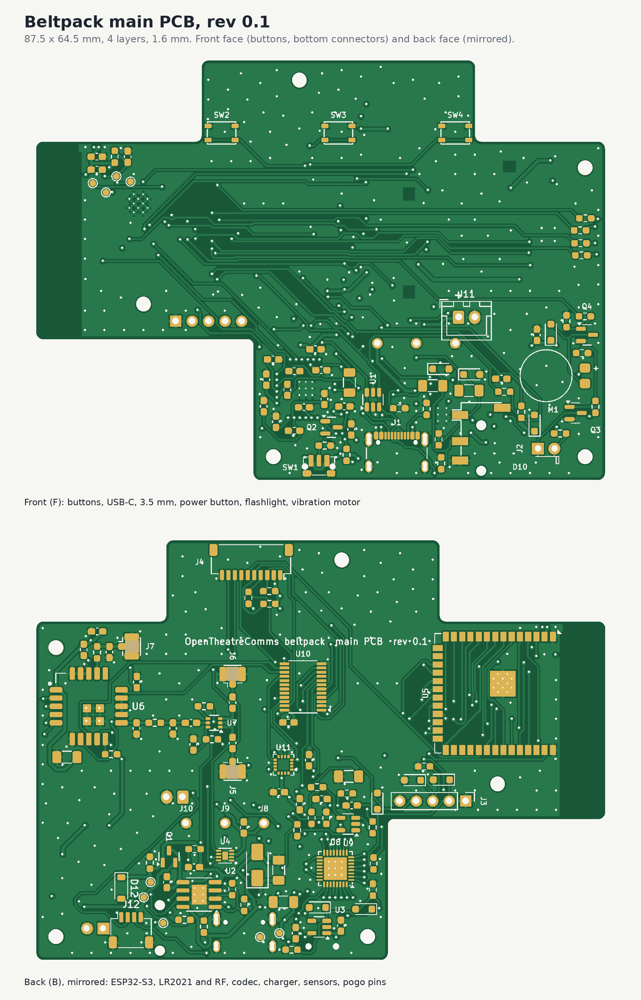

# Beltpack main PCB, rev 0.1

The board behind the front shell: USB-C charging with a power path, the soft power switch and 3.3 V LDO, a fuel gauge,
the ESP32-S3 module, the LR2021 radio module with its antenna-diversity switch and two U.FL outputs, the NAU88C22 codec
with the XLR-4 headset and 3.5 mm TRRS outputs, an accelerometer, an IO expander, the three front buttons, the
flashlight LED, the vibration motor and the JST SH link to the top PCB.

| | |
|---|---|
| Size | 87.5 x 64.5 mm outline with the link tab, 1.6 mm FR4, 4 layers |
| Stack | F signal + GND pour, In1 signal + +3V3 pour, In2 solid GND plane, B signal + GND pour |
| Rules | 0.2 mm track and space, power and +3V3 0.4 mm, RF 0.35 mm, vias 0.6 / 0.3 mm, 0.5 mm copper to edge |
| Parts | 138 parts (59 on the front, 79 on the back; 21 of them unfitted options) plus 5 M2 holes. 0603 passives on hand-solder pads |
| DRC | 0 errors, 0 unconnected. 10 warnings, all expected: footprints adjusted from their library copies (silk moved off the board edge), the enclosure reference footprint has no library, and one pin-1 marker clipped by the mask |

## Files

| Path | Contents |
|---|---|
| `main_pcb.kicad_sch` | Schematic (one A1 sheet, a box per block) |
| `main_pcb.kicad_pcb` | Routed board. *Update PCB from Schematic* matches every footprint to its symbol |
| `main_pcb.kicad_dru` | Custom rules: single thermal spoke, the USB-C and power-switch pegs, the buttons by the tab edge |
| `lib/` | Project symbols and footprints (codec, charger, gauge, RF switch, LR2021 module, spring pin, coin motor) |
| `fab/main_pcb_gerbers.zip` | Gerbers (4 copper layers) + Excellon drill (PTH and NPTH), ready to upload |
| `fab/main_pcb_bom.csv` | BOM grouped by value, with part numbers and side. Unfitted parts are listed with quantity 0 |
| `fab/main_pcb_placement.csv` | Pick-and-place, mm (unfitted parts left out) |
| `fab/assembly.pdf` | Hand-assembly sheets, front and back (back drawn as seen from the back); unfitted parts in grey |
| `fab/main_pcb_schematic.pdf`, `fab/main_pcb_drc.rpt` | Schematic print and the DRC report |

Order as: 4 layers, 1.6 mm, JLC-style 7628 stack (or any 4-layer stack with about 0.2 mm from B to In2: the RF lines
were sized for that), HASL lead-free is fine for reflow (ENIG gives a flatter paste print on the QFN, TDFN and LGA, if you want the margin), any mask colour. The ESP32 and codec footprints have
0.2 mm thermal vias, so allow 0.2 mm drills.

## Circuit

**Power.** USB-C (5.1k CC pull-downs, so it asks for 5 V only) → USBLC6 ESD → TP4056 charger at about 800 mA (R3 = 1.5k;
2.4k gives 500 mA) with the pack NTC on CHG_TEMP (fit R5 instead if the pack has none). Power path: SS14 from VBUS to SYS,
AO3401A from the cell to SYS when USB is absent. TLV75733 (1 A) makes +3V3 from SYS.
Q1's drain is on the cell and its source on SYS. That's deliberate (the usual orientation for a charger with load
sharing): its body diode can only conduct from the cell to SYS, so with USB in, SYS can never charge the cell around the
charger. Don't swap it to source-on-battery: the body diode would then charge the cell straight from USB, with no
current limit, temperature check or end of charge.
Soft power: the side button pulls the LDO enable high through D2; the firmware then holds it with PWR_HOLD (IO17) through
D3, reads the button through Q2 (expander P03), and lets go of PWR_HOLD to switch off. MAX17048 gauge on the cell (0x36).
The pack connects through three spring pins: J8 battery +, J9 NTC, J10 battery −. J11, a JST XH 2-pin on the front above
the spring pins (pin 1 +, marked), is a second battery input in parallel with J8/J10, for a wired cell or bench supply.
A cell on J11 has no NTC: fit R5 to turn the charger's temperature check off.
**Dock:** J12 (JST SH 4-pin, back face, bottom edge, mouth facing down) cables to the dock contact board in the case
bottom: pin 1 dock VBUS, 2 D+, 3 D−, 4 GND. Dock VBUS feeds the pack's VBUS through D12 (B5819W), which also keeps the USB-C's
5 V off the exposed contacts; D+/D− join the USB-C's data lines (full speed, about 55 mm of extra track on D+).

**ESP32-S3** (WROOM-1-N8R8, antenna end over the no-copper strip on the left):

| GPIO | Use | GPIO | Use |
|---|---|---|---|
| IO0 | Boot (test pad) | IO15 | I2S MCLK |
| IO1 | Jack sense | IO16 | Expander INT (shared with the top PCB) |
| IO4 / IO5 / IO6 / IO7 | I2S BCLK / FS / DOUT / DIN | IO17 | PWR_HOLD |
| IO8 / IO9 | I2C SDA / SCL | IO18 | Vibration motor |
| IO10 / IO11 / IO12 / IO13 | LR2021 NSS / MOSI / SCK / MISO | IO19 / IO20 | USB D− / D+ (native USB: flashing and serial) |
| IO14 | LR2021 BUSY | IO21 | LR2021 DIO6 (IRQ) |
| IO38 / IO39 | Left dial A / B | IO40 / IO41 | Right dial A / B |
| IO42 | Flashlight | IO47 | LR2021 NRESET |
| IO48 | Antenna switch | RXD0 / TXD0 | UART test pads |

**IO expander** (TCA9555 at 0x21; the top PCB's is at 0x20): P00 Back, P01 Function, P02 Menu, P03 power button,
P04 charging, P05 charge done, P06 USB present, P07 accelerometer INT1, P10 gauge alert, P11 LR2021 DIO5,
P12 LR2021 TX/RX enable, P13 accelerometer INT2.

**I2C bus**: codec 0x1A, accelerometer (LIS3DH) 0x18, gauge 0x36, main expander 0x21, top expander 0x20, OLED 0x3C.
The pull-ups are on the top PCB; R39 to R41 here are unfitted (fit them only to run this board without the top PCB).

**Radio.** LR2021 module (915 to 928 MHz port) → pi match (C14, L1, C15: 0 ohm and two unfitted shunts until tuned) →
100 pF DC block → PE4259 switch (IO48 high = antenna A) → 100 pF DC blocks → U.FL J5 (antenna A) and J6 (antenna B).
The 2.4 GHz port has a footprint-only match (L2, C20) and U.FL (J7), all unfitted in v1.

**Audio.** NAU88C22 in 2-wire mode. XLR-4 headset (Clear-Com wiring: 1 mic common, 2 mic +, 3 earpiece −, 4 earpiece +,
5 shell) on wire pads J3: dynamic mic into the left mic input, earpiece on the speaker (BTL) outputs. For headsets with
pin 3 tied to pin 1, swap R27 for a 100 uF 1206, remove R28 and fit R29. The unfitted OPA365 preamp (gain 22, 27 dB)
goes between the XLR mic and the codec: fit U9, C31 to C34 and R21 to R26, and remove R20.
3.5 mm TRRS (CTIA) on J2: stereo headphone out through 100 uF, electret mic into the right mic input with 2.2k bias,
jack sense on IO1.

**Other.** LIS3DH accelerometer, three PTS815 front buttons, 3 mm white flashlight LED (about 20 mA from SYS),
coin vibration motor, all ESD-protected where they leave the board. J4 (JST SH 10, mouth up on the tab) has the
same pinout as the top PCB's J1, for a straight pin-1-to-pin-1 cable.

## Check before ordering

1. **LR2021 module footprint: checked.** It now matches Elecrow's own design file for the module: pin 1 at the top of the
   left side seen from the top, numbered anticlockwise, 5 castellated pads per side at 1.27 mm, and four 1.2 mm ground
   pads underneath (each with a via). Every pin's function was checked against that file's nets.
2. **Radio supply link.** The module already has its own ferrite on its supply pin, so FB2 is fitted as a 0 ohm link.
   Its 0603 pads take a 120 ohm bead (BLM18PG121SN1D) if the radio ever needs a quieter supply.
3. **Codec routing.** The codec's support parts now sit beside the vias of the pins they serve: VREF is 5 mm of track,
   each mic pair 5 to 8 mm, the speaker pair 5 to 13 mm, the analog supply 21 mm. The lines to the 3.5 mm jack (headphones,
   mic, mic bias) are 20 to 65 mm because the jack is at the other end of the board.
4. **In1 carries signals too.** About 0.6 m of signal tracks run on In1; the +3V3 pour fills round them, and +3V3 is
   also routed as a net, so it's connected even where the pour is cut. In2 is an unbroken ground plane under everything.
5. **Codec: checked against the NAU88C22 datasheet (Rev 2.2).** MODE low with SPIEN at its default selects 2-wire
   control at 0x1A (0011010), and CSB/GPIO1 to ground follows the "unused digital inputs to ground" note. Following its
   application circuit, MICBIAS now has 4.7 uF (C28) and VDDC/VDDB a 4.7 uF bulk cap (C23) next to the 0.1 uF.
   Its example also puts 220 ohm series resistors on the I2S and I2C lines; this board has none, so add them in rev 0.2
   if the digital lines ring.
6. **Spring pins.** J8 to J10 have 1.0 mm holes for Xinyangze YZ08415060P-02 pins (LCSC C7471674): 0.8 mm tail, 4.5 mm
   free height, 4.0 mm working height, 3.7 mm fully in. The pack pads should sit 4.0 mm from the board's back face (the
   case was drawn for 3.7 mm with Mill-Max pins, so the pack seat moves 0.3 mm in the case redesign). A Mill-Max 0906
   still fits the hole, loosely.
7. **Charge current.** R3 = 1.5k gives about 800 mA. A USB-C port without Power Delivery only promises 500 mA (USB 2.0) or
   900 mA (USB 3.x); 2.4k gives 500 mA if you ever need it.
8. **RF.** The 915 MHz pi match ships as 0 ohm with both shunts unfitted: tune C14, L1, C15 with a VNA. The PE4259 runs at
   3.3 V, its rated maximum supply.
9. **Fit check.** Every part's box was checked against the case model: only the 3.5 mm jack and the flashlight LED reach
   into the front shell, through their openings as intended. The case's power button now has a 0.37 mm nub to reach the
   Alps switch's plunger (updated case files in `beltpack_case`).

## Rebuilding

Everything here is generated from `pcb_main/design.py`. See `pcb_main/README.md` for the build steps. After the scripted
build, one connection needed help: R7 (the LDO enable pull-down) was moved with `movepart.py R7 --free` and its enable
line routed by `maze.py`.
Edit the board by hand in KiCad if you prefer; just don't rerun the scripts afterwards, or they'll overwrite your edits.
