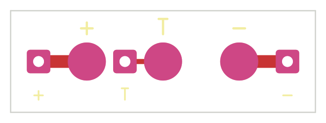
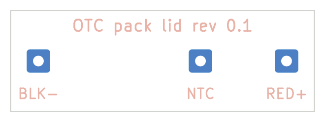

# Beltpack pack lid PCB, rev 0.1

The battery pack's contact board. It sits in the recess in the pack's front face, under the main PCB's three Mill-Max
spring pins, and carries the cell's three leads to them: BAT+, the pack NTC, and BAT-.

| Front (faces the main PCB) | Back (faces the cell) |
|---|---|
|  |  |

| | |
|---|---|
| Size | 24 x 8 mm, 0.8 mm FR4, 2 layers |
| Finish | HASL (with lead) as ordered; the three 3 mm contact pads are bare. ENIG is the upgrade if contact ever gets flaky |
| Parts | None. Three contact pads, three plated wire holes for 0.25 mm2 (24 AWG) wire, and short front-side tracks |
| DRC | 0 errors, 0 unconnected. 4 warnings, both expected: the contact and wire pads have their library silk and courtyards moved off (they are copper, not parts), and the enclosure reference footprint has no library |

## Files

| Path | Contents |
|---|---|
| `pack_lid_pcb.kicad_sch`, `pack_lid_pcb.kicad_pcb` | Schematic and board |
| `fab/pack_lid_pcb_gerbers.zip` | Gerbers + Excellon drill, ready to upload |
| `fab/pack_lid_pcb_schematic.pdf`, `fab/pack_lid_pcb_drc.rpt` | Schematic print and the DRC report |

Order as: 2 layers, 0.8 mm, HASL (with lead) or ENIG, any mask colour. There's nothing to assemble: solder the cell's leads into the holes.

## Pads and wiring

| Contact pad (front) | Spring pin on the main PCB | Wire hole | Wire |
|---|---|---|---|
| J1 at x 6 | J8, battery + | J4 at x 2.2 | Cell + (red), after the cell's protection board |
| J2 at x 12 | J9, pack NTC | J5 at x 9.0 | NTC lead (yellow or white): a 10k B 3435 thermistor taped to the cell, other end to cell - |
| J3 at x 18 | J10, battery - | J6 at x 21.8 | Cell - (black), after the protection board |

The charger on the main PCB (R4 = 6.2k into its TEMP pin) expects the 10k NTC between NTC and BAT-. With a 2-wire
cell and no NTC, fit R5 on the main PCB instead: it ties TEMP to ground and turns the temperature check off.

## Check before ordering

1. **How the wires reach the lid.** The lid sits right against the cell, so wires can't run behind it, and the pack
   tray in the case model holds the cell with only 0.2 mm to spare. The tray needs a wire channel from the cell's
   protection board to the lid, ending at the lid's edge so the leads come in from the front. The solder joints then
   sit on the front face, where the main PCB leaves 2.8 mm or more above them.
2. **Pad wear.** The spring pins compress 0.8 mm onto the pads every time the pack goes in. HASL is fine for a
   prototype (wipe the pads with IPA if contact gets flaky); ENIG lasts longer.

## Rebuilding

Generated from `pcb_lid/design.py`: `python3 make_sch.py`, then `kicad-cli sch export netlist` and `python3 chknet.py`,
then `python3 make_pcb.py` and `python3 make_fab.py`.
