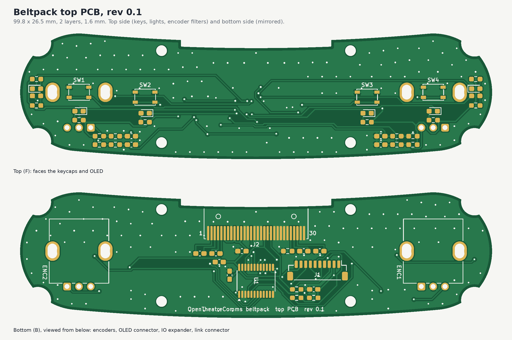

# Beltpack top PCB, rev 0.1

The board under the keys: four talk keys with key lights, a red/green status pair under each end light pipe, the 1.3 in
OLED's FPC connector, both dial encoders with their RC filters, a TCA9555 IO expander, and the JST SH link to the main PCB.

| | |
|---|---|
| Size | 99.8 x 26.5 mm curved pill, 1.6 mm FR4, 2 layers |
| Rules | 0.2 mm track and space, +3V3 0.25 mm, vias 0.6 / 0.3 mm, 0.5 mm copper to edge |
| Pours | GND on both layers, about 100 stitching vias |
| Parts | 49 parts (32 on top, 17 on the bottom) plus 4 M2 holes; 0603 passives on hand-solder pads |
| DRC | 0 errors, 0 unconnected. 7 warnings, all expected: the starter's mounting holes and the two green status LEDs (trimmed silk) differ from the library copies, and the board-only enclosure footprint has no library |

## Files

| Path | Contents |
|---|---|
| `top_pcb.kicad_sch` | Schematic (one A3 sheet) |
| `top_pcb.kicad_pcb` | Routed board. *Update PCB from Schematic* matches every footprint to its symbol |
| `top_pcb.kicad_dru` | One custom rule: a single thermal spoke is enough for the GND pour |
| `fab/top_pcb_gerbers.zip` | Gerbers + Excellon drill (PTH and NPTH), ready to upload |
| `fab/top_pcb_bom.csv` | BOM grouped by value, with part numbers and side |
| `fab/top_pcb_placement.csv` | Pick-and-place, mm, origin at the board centre |
| `fab/assembly.pdf` | Hand-assembly sheets, top and bottom (bottom drawn as seen from below) |
| `fab/top_pcb_schematic.pdf`, `fab/top_pcb_drc.rpt` | Schematic print and the DRC report |

Order as: 2 layers, 1.6 mm, HASL lead-free (ENIG makes the 0.5 mm FPC connector a little easier to solder), any mask colour.

## Circuit

- **Keys**: PTS815 to GND, read by the TCA9555 port 0 (P00 to P03; the expander's internal 100k pull-ups).
- **Key and status lights**: 0603 LEDs from +3V3 through 220 ohm (about 5 mA), sunk by port 1 (P10 to P17). They're off when the pins are inputs.
- **OLED**: SH1106 in I2C mode at 0x3C. Charge-pump caps 0.22 uF, VCOMH and VPP 4.7 uF, IREF 510k. Reset from P04.
- **IO expander**: address 0x20. INT goes to the main PCB. The I2C pull-ups (4.7k) are on this board.
- **Dials**: Alps EC11N1520402 (on the PEC12R footprint), A/B with the Bourns filter (10k pull-up, 10k series, 10 nF), straight to the main PCB.
- **Link J1** (JST SH 10, top entry): 1 GND, 2 +3V3, 3 SDA, 4 SCL, 5 INT, 6 dial L A, 7 dial L B, 8 dial R A, 9 dial R B, 10 GND.

## Check before ordering

1. **OLED pin order.** The panel's tail folds round the notch in the back edge into J2 on the bottom. The pin map assumes the
   panel's pin 1 is at +X: on the left when you look at the panel face up with the tail toward you. Panel pin k then lands on J2 pad 31 - k.
   If your panel is numbered the other way, set `OLED_PIN1_AT_PLUS_X = False` in `pcb_top/design.py` and rebuild.
2. **FPC contact side and length.** The FH12-30S-0.5SH is a bottom-contact ZIF. After the 180 degree fold, the panel's contacts must face the board.
   The connector's entry edge is 0.8 mm inside the notch edge, so check that the tail is long enough to wrap the 1.6 mm board edge and seat fully.
3. **Encoder footprint.** It uses KiCad's PEC12R vertical footprint (3 pins at 2.5 mm, two mounting tabs). The fitted part is
   an Alps EC11N1520402 (no switch, 30 detents / 15 pulses), whose pins match and whose smaller tabs fit the PEC12R slots.
   The firmware counts one step per detent (half a quadrature cycle). Check the shaft length against the case redesign. The encoders sit on the bottom side with their pins toward the front edge.
4. **Status lights.** The red and green 0603s sit 1.5 mm apart under the 2.4 mm light pipe. A single bicolour 0603 would be tidier if you find one you like.
5. **Main PCB side.** Fit no second set of I2C pull-ups there, and keep the SM10B pinout identical, for a straight JST SH cable (pin 1 to pin 1).

## Rebuilding

Everything here is generated from `pcb_top/design.py` (part list, nets and positions). See `pcb_top/README.md` for the build steps.
Autorouting uses Freerouting 1.9, with the OLED-connector fan-outs and the GND fanout vias placed by script first.
Edit the board by hand in KiCad if you prefer; just don't rerun the scripts afterwards, or they'll overwrite your edits.
